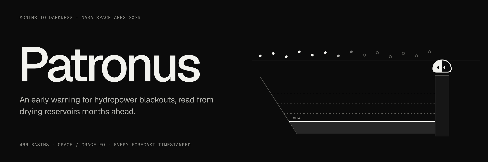

# Patronus: months to darkness

An independent, public early warning for drought-driven hydropower blackouts, built on NASA Earth observation data.
NASA Space Apps Challenge 2026 entry for **"Be An Earth System Trend Detective!"**. Not affiliated with or endorsed by NASA.

**Live site:** https://patronus-blackout-watch.aui-svi.workers.dev

## What it does
When drought drains hydropower reservoirs, the lights go out. Ecuador lost an estimated 1–1.5% of GDP in 2024; Vietnam about $1.4B in 2023; Zambia's 2024 growth forecast was cut from 4.7% to 1.2%. The warning signs were in the data months earlier. Patronus turns them into dated, checkable forecasts.

- **Trend detective (the challenge):** significance-tested GRACE/GRACE-FO water-storage trends for 466 hydropower basins (Mann-Kendall + Sen's slope + FDR). 392 GW of hydropower sits in significantly drying basins: 19 GW with a significant rain decline, 373 GW without one (groundwater, glacier/snow loss, reservoir operations).
- **El Niño exposure:** 54 GW of hydropower sits in 9 grids that lose output under El Niño. This holds in both the full record and a check that excludes years with a known rainfall-data drift.
- **Lake Kariba (Zambia/Zimbabwe):** a 34-year satellite lake-level record (NASA/USDA G-REALM). In a strictly forward backtest, the El Niño reservoir model flagged the 2024 crisis in **July 2023**, 5 months before the official water cut and 8 months before load-shedding. Its live forecast gives a **36% chance** (4 of 11 El Niño analog years) that the lake falls below 10% usable storage by December 2027.
- **Honest scoreboard:** five past crises, hits and misses. The monthly country forecasts are experimental (modest skill). Every limitation is listed on the Proof page.
- **Timestamped forecasts:** every forecast file is SHA-256 hashed and stamped with OpenTimestamps. See [docs/VERIFY.md](docs/VERIFY.md).

Full design, decisions and results: [DESIGN.md](DESIGN.md) (results in §12). Data sources and references: [docs/SOURCES.md](docs/SOURCES.md).

## Run it
```bash
# Web app (reads the precomputed JSON in web/public/data)
cd web && npm install && npm run dev        # or: npm run build -> web/dist (static)

# Data pipeline (Python 3.11+; no API keys or logins needed)
pip install -r requirements.txt
python3 -m pipeline.run_all                 # downloads/caches open data, writes web/public/data/*.json
```
The pipeline expects the large raw files in `data/raw/` (gitignored). Each module's docstring gives its source URL. All sources are open and need no login: Ember, GFZ GravIS (GRACE/GRACE-FO), NASA POWER (MERRA-2), GPCP v2.3, G-REALM, NOAA ONI/CPC, NASA GEOS-S2S, WRI GPPD, HydroBASINS and NASA GIBS (Black Marble).

## Repository layout
| Path | What |
|---|---|
| `pipeline/` | Python data pipeline: `trends`, `enso`, `kariba*`, `generation`/`gen_*`, `nightlights`, `crises`, `scoreboard`, `ledger`, `meta`, `run_all` |
| `web/` | React + TypeScript app (Vite). Theme tokens are in `web/src/theme.css`; the design system is in `DESIGN_SYSTEM.md` |
| `web/public/data/` | Pipeline outputs (JSON contracts in [docs/CONTRACTS.md](docs/CONTRACTS.md)) |
| `data/reference/` | Checked-in data: `forecast/` (pipeline inputs) and `remediation/` (crisis actions, costs, ZRA readings) |
| `docs/` | Contracts, verification guide, sources |

## Team, credits and AI use
Built by Dan, Sean and Arvin for NASA Space Apps 2026. Independent back-tests (Future Detector) by Sean's team are in `docs/BACKTEST-FD.md` and `docs/HEATWAVE-FD.md`, where merged.

AI tools ("Super Intelligence") were used for research, critique, coding and drafting the written briefs. The project concept came from the team. Every number comes from the data pipeline and cited sources. AI-written briefs are labelled in the app.

"Patronus" is used here only as a word. No affiliation with any other product of that name.
